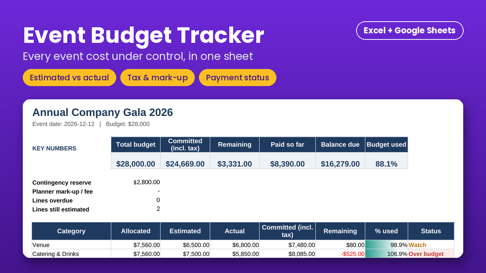
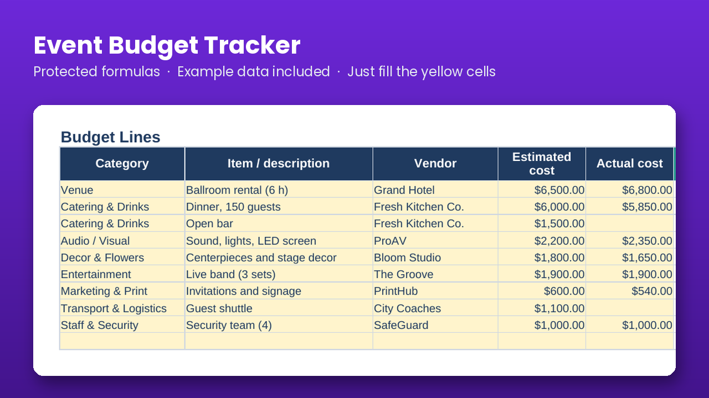
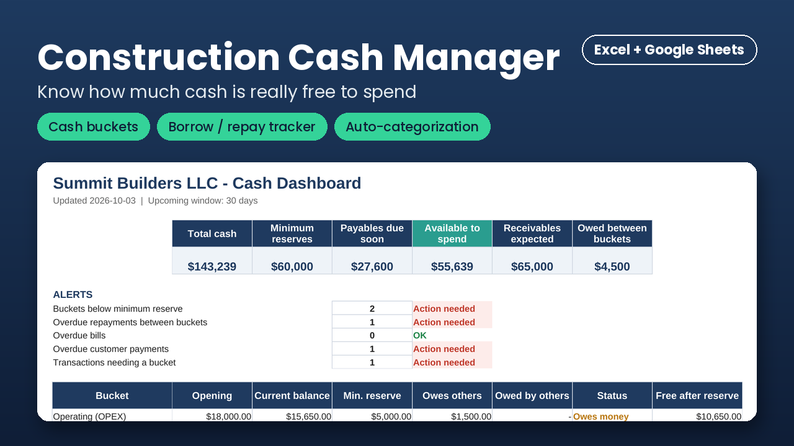
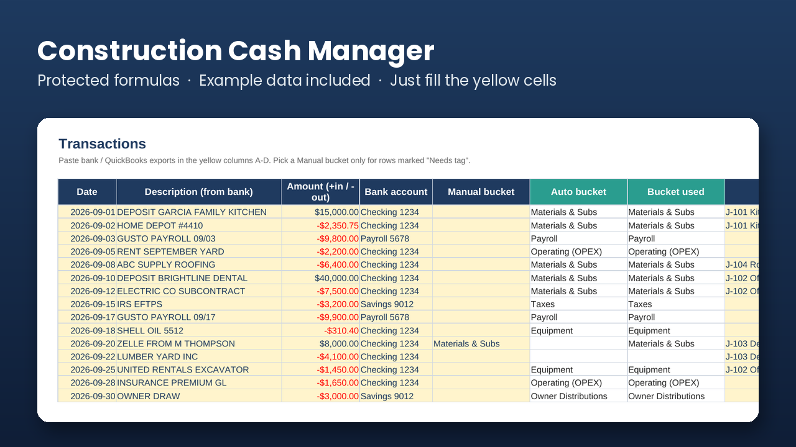

# Excel & Google Sheets Templates

Two finished spreadsheet tools built for real business workflows. Both work in Microsoft Excel and Google Sheets, use only formulas (no macros), and protect every calculated cell so users only type in the yellow input cells.

| Template | For | Formulas | Get it |
|---|---|---|---|
| **Event Budget Tracker** | Event and wedding planners, companies running events | 1,300+ | [Gumroad](https://gum.co/u/lelgzysc) |
| **Construction Cash Manager** | Contractors and small construction companies | 3,500+ | [Gumroad](https://gum.co/u/vuubyo1h) |

---

## Event Budget Tracker

Plan, track and control every event cost in one file.

- **Setup:** your own categories, allocation %, tax / GST rate, contingency % and optional planner mark-up.
- **Budget lines:** estimated vs actual cost, variance in $ and %, tax per line, deposits paid, balance due, due dates and automatic status (Paid / Pending / Overdue).
- **Dashboard:** total budget, committed cost (incl. tax), remaining budget, paid so far, balance due and % of budget used.
- **Category control:** allocated vs estimated vs actual, remaining per category and automatic status (On track / Watch / Over budget), plus a chart.

---

## Construction Cash Manager

Know where every dollar belongs and how much cash is really free to spend.

- **Cash buckets:** Operating, Materials & Subs, Payroll, Taxes, Owner Distributions, Reserves, Equipment (rename or add your own), each with a minimum reserve.
- **Auto-categorization:** paste a bank or QuickBooks export; a keyword Rules table assigns each transaction to a bucket and cost type. Unrecognized rows are flagged "Needs tag".
- **Borrow / repay tracker:** log a transfer between buckets once and the workbook shows who owes whom, how much is still owed and which repayments are overdue.
- **Dashboard and alerts:** total cash, minimum reserves, payables due soon, available to spend, receivables expected, amounts owed between buckets, and alerts for buckets below reserve, overdue repayments, overdue bills and untagged transactions.
- **Jobs, payables and receivables** with automatic Overdue / Due soon status.

### Formula design note

Keyword rules are matched with a single `SUMPRODUCT` over the Rules table (`ISNUMBER(SEARCH(keyword, description))`) that returns the **first** matching rule, so more specific keywords placed higher in the table win over generic ones (for example `UNITED RENTALS` before `RENT`). No helper columns, no macros, and it works the same in Excel and Google Sheets.

---

## About

Built by Juan Giles, Industrial & Systems Engineering student with production-area experience in a manufacturing plant. I build Excel / Google Sheets tools, KPI dashboards and Python data-cleaning scripts.

More work: [Production KPI Dashboard (OEE)](https://github.com/JuanGiles260/production-kpi-dashboard) · [Inventory Tracker](https://github.com/JuanGiles260/inventory-tracker-sheets) · [CSV Cleaner](https://github.com/JuanGiles260/csv-cleaner)

Need a custom version for your business? Contact me through Upwork, Fiverr or Gumroad.
